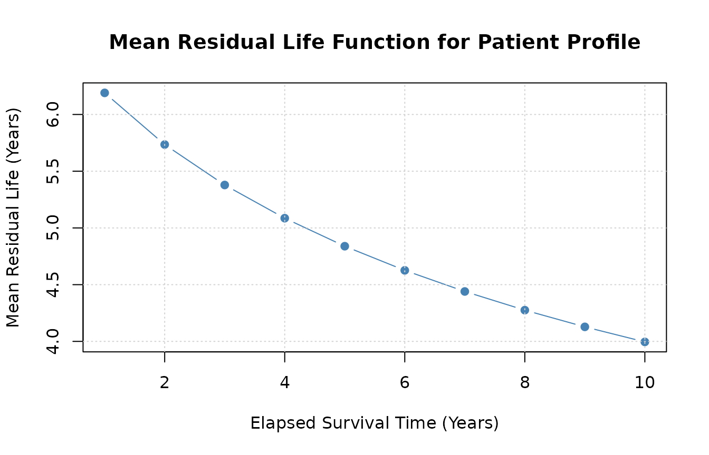
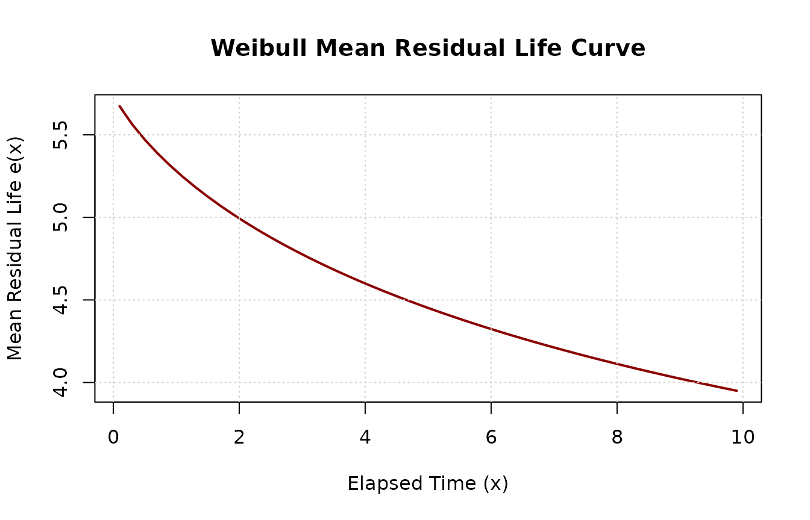

# 'reslife' Package Demonstration

The mathematical derivations, integral forms, and distribution
specifications implemented in this package are detailed in the companion
paper: [Wang et al. (2025)](https://arxiv.org/pdf/2308.07410.pdf).

## Load the Package

``` r

library(reslife)
#> Loading required package: pracma
#> Loading required package: flexsurv
#> Loading required package: survival
#> Loading required package: gsl
#> 
#> Attaching package: 'gsl'
#> The following objects are masked from 'package:pracma':
#> 
#>     Ci, erf, erfc, eta, expint_E1, expint_Ei, fact, hypot, psi, Si,
#>     sinc, zeta
library(flexsurv)
library(survival)
```

------------------------------------------------------------------------

## Demonstration of the `reslifefsr` Function

The
[`reslifefsr()`](https://kaloklee.github.io/reslife/reference/reslifefsr.md)
function calculates residual life values directly from a fitted
`flexsurvreg` object. It supports both baseline (intercept-only) models
and models with patient-level covariate profiles via `newdata`.

### Baseline Verification via Numerical Integration

We begin by fitting an intercept-only generalized gamma model
(`gengamma.orig`) to the breast cancer dataset `bc` from `flexsurv`. We
then evaluate the mean residual life at an elapsed time of 1 year
(`life = 1`).

``` r

fs1 <- flexsurvreg(Surv(recyrs, censrec) ~ 1, data = bc, dist = "gengamma.orig")
r <- reslifefsr(obj = fs1, life = 1, type = "mean")
r
#> [1] 7.194108
```

We can verify the accuracy of this analytical derivation against direct
numerical integration of the survival function:
``` math
\text{MRL}(x) = \frac{1}{S(x)} \int_x^\infty S(t) \, dt
```

``` r

# Extract parameters on their natural scale from the fitted model
b <- as.numeric(fs1$res["shape", "est"])
a <- as.numeric(fs1$res["scale", "est"])
k <- as.numeric(fs1$res["k", "est"])

# Define survival function
surv_gengamma <- function(t) {
  pgengamma.orig(t, shape = b, scale = a, k = k, lower.tail = FALSE)
}

# Numerical integration
integral_val <- integrate(surv_gengamma, lower = 1, upper = Inf)$value
sx_val <- surv_gengamma(1)
mx_integral <- integral_val / sx_val

all.equal(r, mx_integral)
#> [1] "Mean relative difference: 1.597394e-08"
```

The analytical formula in
[`reslifefsr()`](https://kaloklee.github.io/reslife/reference/reslifefsr.md)
matches numerical integration.

------------------------------------------------------------------------

### Covariate Models with Multiple Predictors

When a model includes covariates,
[`reslifefsr()`](https://kaloklee.github.io/reslife/reference/reslifefsr.md)
evaluates residual life across patient profiles. We illustrate this
using the `bc` dataset with an added covariate `age`:

``` r

set.seed(42)
newbc <- bc
newbc$age <- rnorm(nrow(bc), mean = 65 - scale(newbc$recyrs, scale = FALSE), sd = 5)

fsr2 <- flexsurvreg(Surv(recyrs, censrec) ~ group + age, data = newbc, dist = "weibull")
```

Evaluating residual life across the fitted observations returns a vector
with one value per observation:

``` r

head(reslifefsr(obj = fsr2, life = 4, type = "mean"), 5)
#> [1] 244.6992
```

We can also inspect the median residual life:

``` r

head(reslifefsr(obj = fsr2, life = 4, type = "median"), 5)
#> [1] 209.3608
```

Or extract the full summary table (`mean`, `median`, and a custom
`quantile`):

``` r

head(reslifefsr(obj = fsr2, life = 4, p = 0.8, type = "all"), 5)
#>       mean   median percentile
#> 1 244.6992 209.3608   376.0821
```

------------------------------------------------------------------------

### Predicting on New Covariate Profiles (`newdata`)

We can evaluate specific patient profiles by passing a `data.frame` to
`newdata`:

``` r

newdata <- data.frame(
  group = c("Medium", "Good", "Poor"),
  age   = c(43, 35, 39)
)

reslifefsr(obj = fsr2, life = 4, p = 0.6, type = "all", newdata = newdata)
#>        mean    median percentile
#> 1 13.988900 11.528209  14.370289
#> 2 39.695764 33.514429  41.148687
#> 3  9.325262  7.571392   9.512931
```

[`reslifefsr()`](https://kaloklee.github.io/reslife/reference/reslifefsr.md)
is invariant to column order:

``` r

# Reordered columns produce identical results
newdata_reorder <- data.frame(age = c(43, 35, 39), group = c("Medium", "Good", "Poor"))
reslifefsr(obj = fsr2, life = 4, p = 0.6, type = "all", newdata = newdata_reorder)
#>        mean    median percentile
#> 1 13.988900 11.528209  14.370289
#> 2 39.695764 33.514429  41.148687
#> 3  9.325262  7.571392   9.512931
```

Extra unmodeled columns are safely ignored:

``` r

newdata_extra <- cbind(newdata, extra = c(100, 100, 100))
reslifefsr(obj = fsr2, life = 4, p = 0.6, type = "all", newdata = newdata_extra)
#>        mean    median percentile
#> 1 13.988900 11.528209  14.370289
#> 2 39.695764 33.514429  41.148687
#> 3  9.325262  7.571392   9.512931
```

------------------------------------------------------------------------

### Error Handling & Input Guards

If required covariates are missing,
[`reslifefsr()`](https://kaloklee.github.io/reslife/reference/reslifefsr.md)
informs the user:

``` r

newdata_missing <- data.frame(group = c("Medium", "Good", "Poor"))
reslifefsr(obj = fsr2, life = 4, type = "all", newdata = newdata_missing)
#> Error in `form.model.matrix()`:
#> ! Value of covariate "age" not supplied in "newdata"
```

Similarly, if an invalid factor level is supplied:

``` r

newdata_bad_level <- data.frame(group = c("Medium", "Good", "InvalidLevel"), age = c(43, 35, 39))
reslifefsr(obj = fsr2, life = 4, type = "all", newdata = newdata_bad_level)
#> Error in `model.frame.default()`:
#> ! factor group has new levels InvalidLevel
```

------------------------------------------------------------------------

### Plotting Mean Residual Life over Time

We can evaluate how residual life changes over elapsed time $`x`$ for a
specific patient profile:

``` r

patient1 <- newbc[1, ]
time_grid <- 1:10

mrl_vals <- sapply(time_grid, function(t0) {
  reslifefsr(obj = fsr2, life = t0, type = "mean", newdata = patient1)
})

plot(time_grid, mrl_vals, type = "b", pch = 19, col = "steelblue",
     xlab = "Elapsed Survival Time (Years)",
     ylab = "Mean Residual Life (Years)",
     main = "Mean Residual Life Function for Patient Profile")
grid()
```



------------------------------------------------------------------------

## Demonstration of the `residlife` Function

The standalone function
[`residlife()`](https://kaloklee.github.io/reslife/reference/residlife.md)
computes residual life directly from distribution names and parameter
vectors without requiring a `flexsurvreg` object.

Supported distributions include: \* `"exponential"` / `"exp"` \*
`"weibull"` \* `"gamma"` \* `"gompertz"` \* `"lognormal"` / `"lnorm"` \*
`"llogis"` \* `"gengamma"` \* `"gengamma.orig"` \* `"genf"` \*
`"genf.orig"`

### Basic Usage with Vectorized Values

[`residlife()`](https://kaloklee.github.io/reslife/reference/residlife.md)
accepts a numeric vector of elapsed times:

``` r

t_seq <- seq(1, 10, by = 1)
pars_weibull <- c(shape = 1.272, scale = 6.191)

residlife(values = t_seq, distribution = "weibull", parameters = pars_weibull, type = "mean")
#>  [1] 5.280618 4.994025 4.776287 4.599837 4.451537 4.323832 4.211904 4.112464
#>  [9] 4.023161 3.942246
```

### Flexible Parameter Naming & Ordering

Parameter order does not matter as long as names match:

``` r

# Unordered names work identically
residlife(values = 5, distribution = "weibull", parameters = c(scale = 6.191, shape = 1.272))
#> [1] 4.451537
```

For distributions with alternative parameterizations like Gamma (rate
vs. scale),
[`residlife()`](https://kaloklee.github.io/reslife/reference/residlife.md)
seamlessly converts between them:

``` r

# Parameterized by scale
residlife(values = 5, distribution = "gamma", parameters = c(shape = 1.272, scale = 6.191))
#> [1] 6.988622

# Parameterized by rate (rate = 1 / scale)
residlife(values = 5, distribution = "gamma", parameters = c(shape = 1.272, rate = 1 / 6.191))
#> [1] 6.988622
```

### Summary Table for All Metrics

``` r

residlife(values = c(1, 3, 5), distribution = "weibull", parameters = pars_weibull, p = 0.75, type = "all")
#>       mean   median percentile
#> 1 5.280618 4.151524   7.446750
#> 2 4.776287 3.629997   6.759695
#> 3 4.451537 3.314545   6.293929
```

### Plotting MRL Directly from `residlife`

Because
[`residlife()`](https://kaloklee.github.io/reslife/reference/residlife.md)
natively vectorizes over `values`, generating an MRL curve requires no
manual loops:

``` r

times <- seq(0.1, 10, by = 0.2)
mrl_curve <- residlife(values = times, distribution = "weibull", parameters = pars_weibull, type = "mean")

plot(times, mrl_curve, type = "l", lwd = 2, col = "darkred",
     xlab = "Elapsed Time (x)",
     ylab = "Mean Residual Life e(x)",
     main = "Weibull Mean Residual Life Curve")
grid()
```



------------------------------------------------------------------------

## References

To cite the `reslife` package or the theoretical derivations in
publications, please use:

- Wang, Z., Crawford, A., Lee, K. L., Lu, L., & Jaganathan, S. (2025).
  *reslife: Residual Lifetime Analysis Tool in R*. arXiv preprint
  [arXiv:2308.07410](https://arxiv.org/abs/2308.07410).

``` bibtex
@article{wang2025reslife,
  title   = {reslife: Residual Lifetime Analysis Tool in R},
  author  = {Wang, Zekai and Crawford, Andrew and Lee, Ka Lok and Lu, Lin and Jaganathan, Srihari},
  journal = {arXiv preprint arXiv:2308.07410},
  year    = {2025},
  url     = {https://arxiv.org/abs/2308.07410}
}
```

------------------------------------------------------------------------

## Session Information

``` r

sessionInfo()
#> R version 4.6.2 (2026-10-29)
#> Platform: x86_64-pc-linux-gnu
#> Running under: Ubuntu 26.04.1 LTS
#> 
#> Matrix products: default
#> BLAS:   /usr/lib/x86_64-linux-gnu/openblas-pthread/libblas.so.3 
#> LAPACK: /usr/lib/x86_64-linux-gnu/openblas-pthread/libopenblasp-r0.3.32.so;  LAPACK version 3.12.0
#> 
#> locale:
#>  [1] LC_CTYPE=C.UTF-8       LC_NUMERIC=C           LC_TIME=C.UTF-8       
#>  [4] LC_COLLATE=C.UTF-8     LC_MONETARY=C.UTF-8    LC_MESSAGES=C.UTF-8   
#>  [7] LC_PAPER=C.UTF-8       LC_NAME=C              LC_ADDRESS=C          
#> [10] LC_TELEPHONE=C         LC_MEASUREMENT=C.UTF-8 LC_IDENTIFICATION=C   
#> 
#> time zone: UTC
#> tzcode source: system (glibc)
#> 
#> attached base packages:
#> [1] stats     graphics  grDevices utils     datasets  methods   base     
#> 
#> other attached packages:
#> [1] reslife_0.3.0   gsl_2.1-9       flexsurv_2.3.2  survival_3.8-12
#> [5] pracma_2.4.6   
#> 
#> loaded via a namespace (and not attached):
#>  [1] sass_0.4.10         generics_0.1.4      tidyr_1.3.2        
#>  [4] lattice_0.23-1      digest_0.6.39       magrittr_2.0.5     
#>  [7] evaluate_1.0.5      grid_4.6.2          RColorBrewer_1.1-3 
#> [10] mvtnorm_1.4-2       fastmap_1.2.0       jsonlite_2.0.0     
#> [13] Matrix_1.7-6        mstate_0.3.3        deSolve_1.42       
#> [16] purrr_1.2.2         scales_1.4.0        numDeriv_2016.8-1.1
#> [19] textshaping_1.0.5   jquerylib_0.1.4     cli_3.6.6          
#> [22] rlang_1.3.0         splines_4.6.2       withr_3.0.3        
#> [25] cachem_1.1.0        yaml_2.3.12         otel_0.2.0         
#> [28] tools_4.6.2         dplyr_1.2.1         ggplot2_4.0.3      
#> [31] assertthat_0.2.1    vctrs_0.7.3         R6_2.6.1           
#> [34] lifecycle_1.0.5     muhaz_1.2.6.5       fs_2.1.0           
#> [37] ragg_1.5.2          pkgconfig_2.0.3     desc_1.4.3         
#> [40] pkgdown_2.2.1       pillar_1.11.1       bslib_0.12.0       
#> [43] gtable_0.3.6        glue_1.8.1          data.table_1.18.6.1
#> [46] Rcpp_1.1.2          statmod_1.5.2       systemfonts_1.3.2  
#> [49] xfun_0.62           tibble_3.3.1        tidyselect_1.2.1   
#> [52] knitr_1.52          farver_2.1.2        htmltools_0.5.9    
#> [55] rmarkdown_2.32      compiler_4.6.2      S7_0.2.2           
#> [58] quadprog_1.5-8
```
